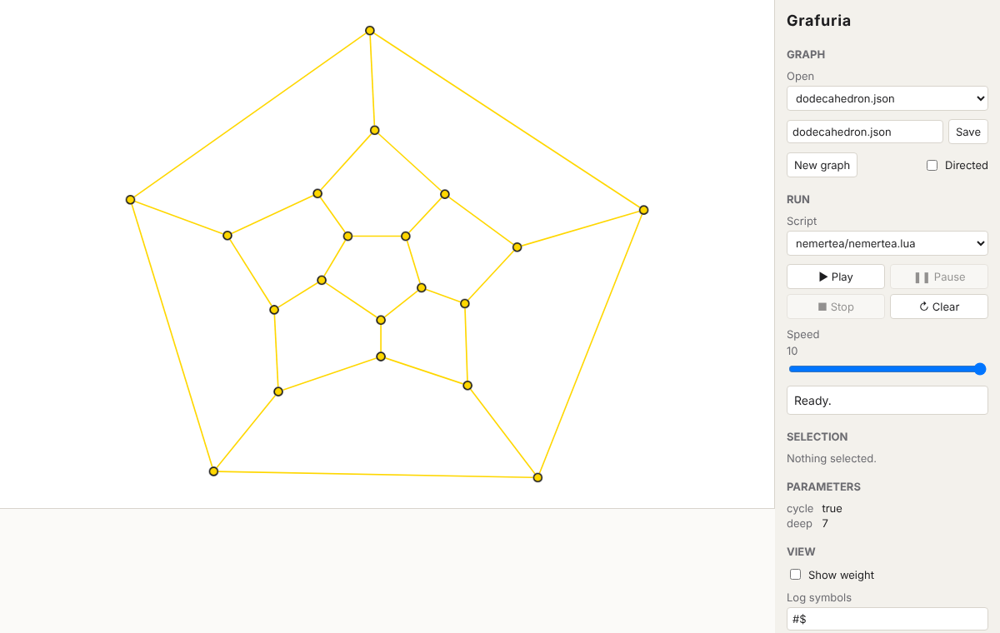
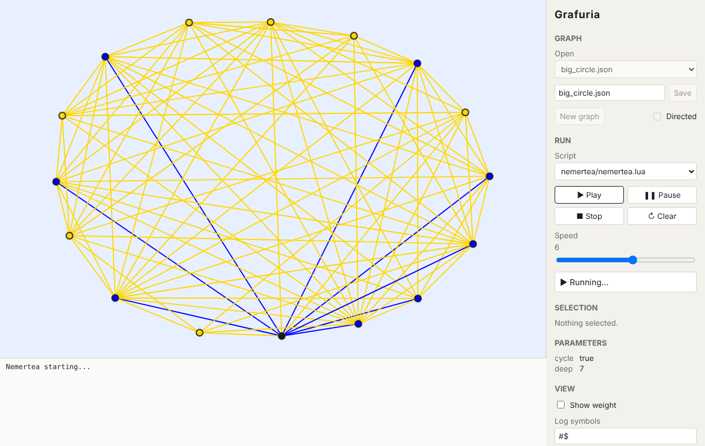
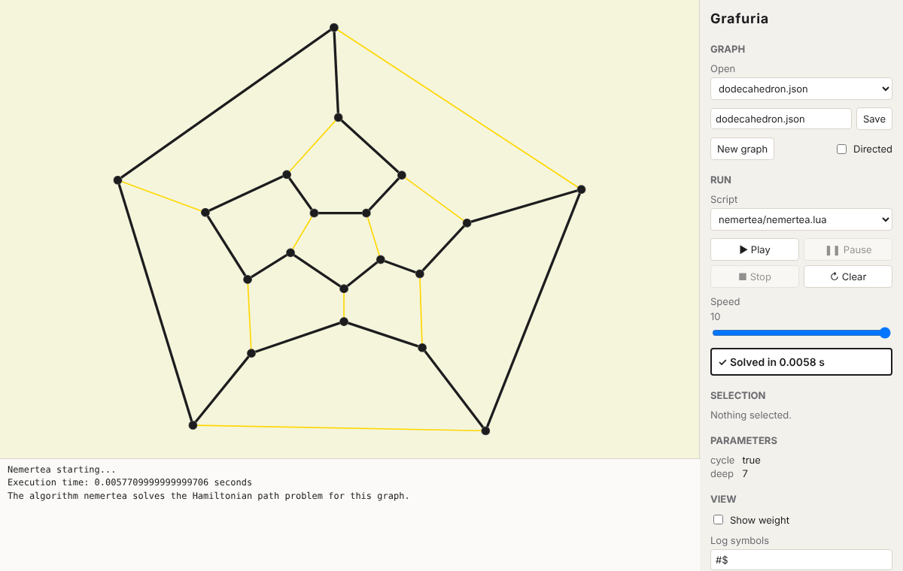
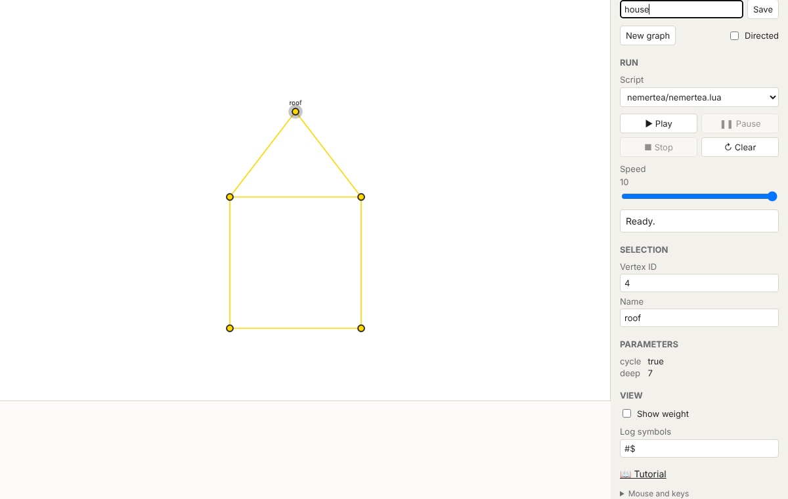
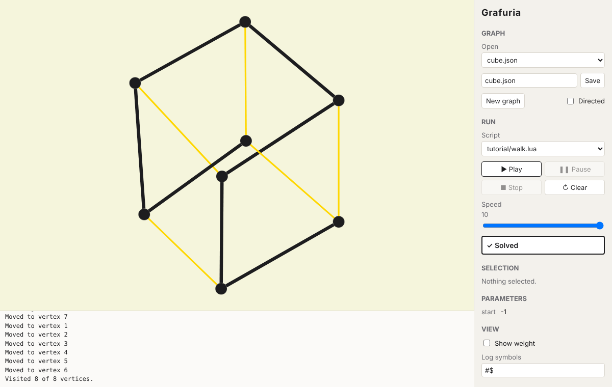

# Grafuria Tutorial

Grafuria is for **drawing graphs and watching algorithms work on them**, step by step, on the screen.

Algorithms are written in **Lua** or **Python**.

This tutorial has two parts:

1. **Using Grafuria**: open it, run ready-made algorithms, draw and save graphs.
2. **Writing your first algorithm**, in Lua and in Python.

*Leia este tutorial em português: [versão em português](tutorial.pt.md).*

---

## 1. Install and open

You need **Python 3.10 or newer**.

In the Grafuria folder, install the dependencies once:

```sh
pip install -r requirements.txt
```

Then, to open it:

```sh
python3 main.py --web
```

The browser opens by itself. If it does not, copy the address shown in the terminal (something like `http://127.0.0.1:8765/`).

On Windows, use `python` instead of `python3`.

To close it, go back to the terminal and press **Ctrl+C**.

> **Your machine only.** Algorithms run real code on your computer. That is why Grafuria only accepts connections from the computer itself. Do not try to put it on the internet.

---

## 2. The screen



- **On the left**, the graph area. The mouse wheel zooms; dragging the background moves the view.
- **At the bottom**, the **log**: the messages the algorithm writes.
- **On the right**, the panel:
  - **Graph**: open, save and create graphs.
  - **Run**: choose the algorithm and control the run.
  - **Selection**: details of the selected vertex or edge.
  - **Parameters**: the algorithm's parameters.
  - **View**: display options.

---

## 3. Run a ready-made algorithm

1. In **Graph → Open**, choose `dodecahedron.json`.
2. In **Run → Script**, choose `nemertea/nemertea.lua`.
3. Press **Play**.

Too fast? Drag **Speed** to 5 or 6 and press **Play** again. Now you can follow it:



### What the colours mean

| Colour | State | Meaning |
|---|---|---|
| Yellow | `NONE` | not touched yet |
| Blue | `TESTING` | being tested now |
| Black (thick edge) | `ACTIVE` | part of the answer |
| Orange | `INVALID` | discarded |

The algorithm chooses these colours: it changes the **state** of each vertex and edge.

### The result

When the algorithm ends, the status box shows **✓ Solved** or **✗ Not solved**.



### The buttons

- **Play**: starts. If paused, resumes.
- **Pause**: pauses.
- **Stop**: interrupts.
- **Clear**: removes the colours and the log, leaving the graph as it was.

### The log

Algorithm messages start with a **symbol**, such as `#` or `$`.

In **View → Log symbols** you choose which symbols are shown. With `#$`, both appear. Only `#` hides the details marked with `$`.

### Tip for classes

You can open Grafuria with a graph and an algorithm already chosen, through the address:

```
http://127.0.0.1:8765/?graph=dodecahedron.json&script=nemertea/nemertea.lua&play=1
```

`play=1` starts the run right away.

---

## 4. Draw a graph

Press **New graph** to start from scratch.

| To… | Do |
|---|---|
| create a vertex | **double click** on empty space |
| connect two vertices | **click** the first, then **Shift+click** the second |
| move | **drag** the vertex |
| delete | select it and press **Delete** |
| name a vertex | select it and type in **Selection → Name** |
| change an edge weight | click the edge and type in **Selection → Weight** |



Tick **Directed** for a directed graph (edges get arrows).

To **save**, type a name in the field next to **Save** (for example `house`) and press **Save**. The file goes to the `graphs/` folder, as `house.json`.

While an algorithm runs, editing is locked.

---

## 5. Your first algorithm

### The idea: a greedy walk

We will write a simple algorithm:

1. Start at a vertex.
2. Move to a neighbour **not visited yet**.
3. Repeat until there is nowhere left to go.

If it visits **every** vertex, it found a **Hamiltonian path**: a path through all vertices, each one once.

It is "greedy" because it takes the first free neighbour it finds, without thinking ahead. Sometimes it succeeds, sometimes it gets stuck halfway.

### Where algorithms live

In the `scripts/` folder. Each algorithm is a `.lua` or `.py` file.

The algorithm of this tutorial is ready in `scripts/tutorial/`:

- `walk.lua`: the Lua version;
- `walk.py`: the same thing in Python;
- `walk.json`: the **parameters** (same name as the script).

### The code, piece by piece

Grafuria gives your script two ready objects:

- **`app`**: Grafuria itself. Gives access to the graph, the log, the speed.
- **`State`**: the states (`State.NONE`, `State.TESTING`, `State.ACTIVE`, `State.INVALID`).

**Choose where to start.** The `start` parameter comes from `walk.json`. If it is `-1`, we pick a random vertex:

```lua
local start
if app:get_var("start") == -1 then
    start = app:get_vertex(math.random(1, app:get_vertex_size())) -- Lua: 1..n
else
    start = app:get_vertex_by_id(app:get_var("start"))
end
```

Note: `get_vertex` uses the vertex **position** in the list (in Lua, from 1 to n), and `get_vertex_by_id` uses the vertex **number** (id) in the file.

**Mark the start:**

```lua
local current = start
current:set_state(State.ACTIVE)
local visited = 1
app:log("#Starting at vertex " .. current:get_id())
```

The `#` at the beginning of the message is the log symbol (section 3).

**The walk.** For each vertex, we look at its edges, one by one, looking for a neighbour that is still yellow (`State.NONE`):

```lua
while not app:is_stopped() do
    local next_vertex, next_edge = nil, nil

    for i = 1, current:get_edge_size() do
        local edge = current:get_edge(i)
        local neighbour = current:get_adjacent(edge)
        if neighbour:get_state() == State.NONE then
            neighbour:set_state(State.TESTING) -- show the candidate
            app:step()                         -- pause, as the speed says
            next_vertex, next_edge = neighbour, edge
            break
        end
    end

    if not next_vertex then
        break -- stuck: every neighbour was visited
    end

    next_edge:set_state(State.ACTIVE)
    next_vertex:set_state(State.ACTIVE)
    current = next_vertex
    visited = visited + 1
    app:log("$Moved to vertex " .. current:get_id())
end
```

Two calls deserve attention:

- **`app:step()`** makes the pause that lets you **see** the algorithm work. The lower the speed, the longer the pause.
- **`app:is_stopped()`** becomes true when someone presses **Stop**. A loop that does not ask it cannot be interrupted.

**The result:**

```lua
local total = app:get_vertex_size()
app:log("#Visited " .. visited .. " of " .. total .. " vertices.")
app:set_solved(visited == total)
```

`set_solved` decides between **✓ Solved** and **✗ Not solved**.

### Running it

1. Open `cube.json`.
2. Choose the script `tutorial/walk.lua`.
3. Press **Play** a few times. Each run starts at a random vertex.



Sometimes it visits all 8 vertices, sometimes it gets stuck earlier. That is the price of being greedy.

**To change the algorithm**, edit the file in your favourite editor, save it and press **Play** again. Grafuria reads the file on every run.

### The same thing in Python

The file `walk.py` does exactly the same. The differences are in the language:

| Lua | Python |
|---|---|
| `app:log(...)` (colon) | `app.log(...)` (dot) |
| positions from **1** to n | positions from **0** to n-1 |
| `math.random(1, n)` | `random.randint(0, n - 1)` |
| `nil`, `true`, `false` | `None`, `True`, `False` |
| `"a" .. x` | `f"a{x}"` |
| `for i = 1, n do ... end` | `for i in range(n):` |

The most important difference is **positions**: `app:get_vertex(1)` in Lua is `app.get_vertex(0)` in Python.

### Parameters

The file `walk.json` has the same name as the script and holds the parameters:

```json
{
    "start": -1
}
```

The script reads it with `app:get_var("start")`. Change `-1` to a vertex id (for example `1`) and the walk always starts there.

A numeric parameter can have limits, with `_min` and `_max`:

```json
{
    "deep": 7,
    "deep_min": 1,
    "deep_max": 20
}
```

In the desktop interface this becomes a slider. In the web interface, for now, parameters are only displayed: to change them, edit the `.json`.

---

## 6. Exercises

**1. Path or cycle?**
Run the walk several times on `petersen.json`. Sometimes it says **✓ Solved**. But the Petersen graph **has no Hamiltonian cycle**! The walk finds *paths*, not *cycles*.
Change the end of the script so it only counts as solved if, besides visiting everything, the last vertex is a neighbour of the first. Hint: `current:is_connected(start)`.

**2. A better choice**
Instead of the first free neighbour, go to the free neighbour that has the **fewest free neighbours** (Warnsdorff's rule, famous in the knight's tour problem).
Compare both versions on `chessboard.json`.

**3. Measure the time**
Measure how long the walk takes and report it with `app:set_execution_time(seconds)`. The time shows in the status.
Hint: in Lua, `os.clock()`; in Python, `time.perf_counter()`.

**4. Go back**
When the walk gets stuck, it gives up. What if it went back one step and tried another neighbour? That is **backtracking**.
After trying, compare with `scripts/hamilton_brute.lua`.

**To compare versions over many runs**, Grafuria runs without a window and prints a table:

```sh
python3 main.py --headless graph=graphs/chessboard.json script=scripts/tutorial/walk.lua runs=100 seed=1
```

---

## 7. Quick reference

### `app`

| Method | What it does |
|---|---|
| `log(text)` | writes to the log (the first character is the symbol) |
| `step()` | pauses as the speed says; call it inside loops |
| `is_stopped()` | true if **Stop** was pressed |
| `set_solved(bool)` | reports whether it solved |
| `set_execution_time(seconds)` | reports the time spent |
| `get_var(name)` | reads a parameter from the `.json` |
| `get_vertex_size()` | number of vertices |
| `get_vertex(position)` | vertex by position (Lua 1..n, Python 0..n-1) |
| `get_vertex_by_id(id)` | vertex by its id in the file |

### Vertex

| Method | What it does |
|---|---|
| `get_id()`, `get_name()` | id and name |
| `get_x()`, `get_y()` | position |
| `get_state()`, `set_state(state)` | reads or changes the state (the colour) |
| `get_edge_size()` | number of edges |
| `get_edge(position)` | edge by position (Lua 1..n, Python 0..n-1) |
| `get_adjacent(edge)` | the vertex on the other side of the edge |
| `get_edge_to(vertex)` | the edge to another vertex (or nothing) |
| `is_connected(vertex)` | true if they are neighbours |
| `get_active_edge_size()` | how many edges are `ACTIVE` |
| `set_var(name, value)`, `get_var(name)` | your own notes on the vertex (cleared on every run) |

### Edge

| Method | What it does |
|---|---|
| `get_id()` | id |
| `get_a()`, `get_b()` | the two vertices |
| `get_adjacent(vertex)` | the vertex on the other side |
| `get_state()`, `set_state(state)` | reads or changes the state |
| `get_weight()`, `set_weight(weight)` | reads or changes the weight |

---

## 8. When something goes wrong

- **"Choose a graph and a script first."**: the graph or the script is missing.
- **Script error**: the message shows in the log, in italics, with the file and line of the problem.
- **I cannot stop the algorithm**: the loop must ask `app:is_stopped()`.
- **Unexpected `nil` or `None`**: check positions. Lua starts at 1; Python at 0.
- **My script is not in the list**: it must be inside the `scripts/` folder.
- **I changed the script and nothing changed**: save the file and press **Play** again.
- **Port 8765 is busy**: Grafuria uses the next free one. The right address shows in the terminal.

The full reference is in the [project README](https://github.com/saulopz/grafuria#readme).
