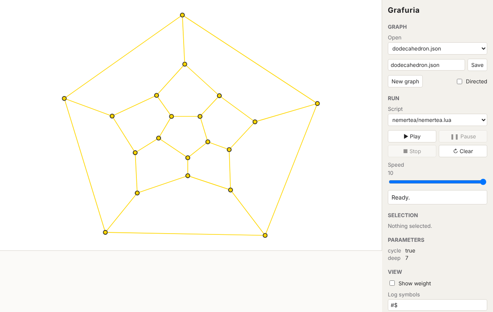
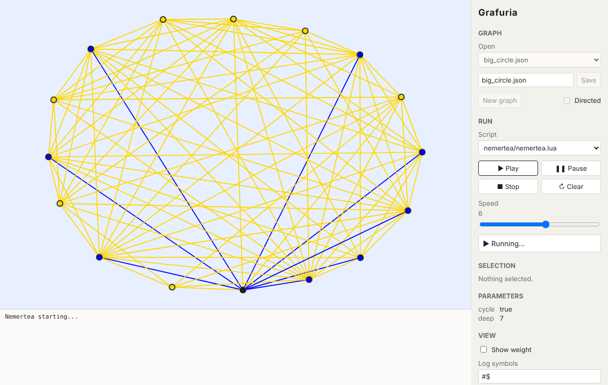
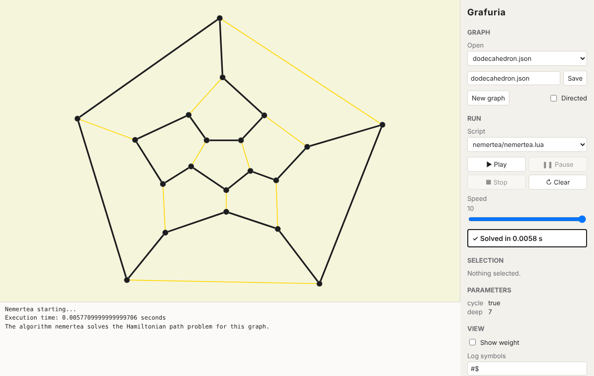
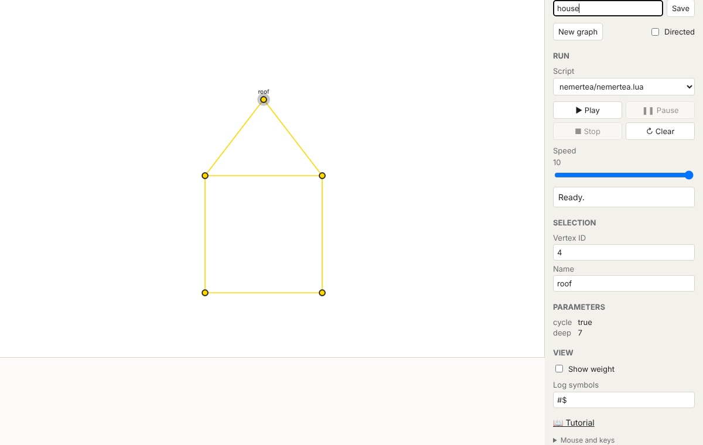
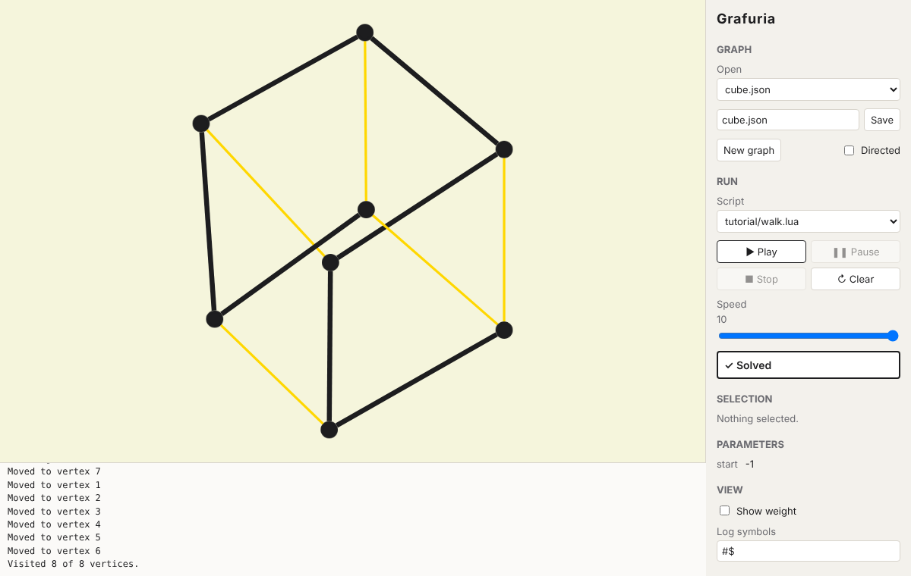

# Tutorial do Grafuria

O Grafuria serve para **desenhar grafos e ver algoritmos trabalhando sobre eles**, passo a passo, na tela.

Os algoritmos são escritos em **Lua** ou **Python**.

Este tutorial tem duas partes:

1. **Usar o Grafuria**: abrir, rodar algoritmos prontos, desenhar e salvar grafos.
2. **Escrever o seu primeiro algoritmo**, em Lua e em Python.

*Read this tutorial in English: [English version](tutorial.en.md).*

---

## 1. Instalar e abrir

Você precisa do **Python 3.10 ou mais novo**.

Na pasta do Grafuria, instale as dependências uma vez:

```sh
pip install -r requirements.txt
```

Depois, para abrir:

```sh
python3 main.py --web
```

O navegador abre sozinho. Se não abrir, copie o endereço que aparece no terminal (algo como `http://127.0.0.1:8765/`).

No Windows, use `python` no lugar de `python3`.

Para fechar, volte ao terminal e aperte **Ctrl+C**.

> **Só na sua máquina.** Os algoritmos rodam código de verdade no seu computador. Por isso o Grafuria só aceita conexões do próprio computador. Não tente colocá-lo na internet.

---

## 2. A tela



- **À esquerda**, a área do grafo. A roda do mouse dá zoom; arrastar o fundo move a vista.
- **Embaixo**, o **log**: as mensagens que o algoritmo escreve.
- **À direita**, o painel:
  - **Graph**: abrir, salvar e criar grafos.
  - **Run**: escolher o algoritmo e controlar a execução.
  - **Selection**: detalhes do vértice ou aresta selecionado.
  - **Parameters**: os parâmetros do algoritmo.
  - **View**: opções de visualização.

---

## 3. Rodar um algoritmo pronto

1. Em **Graph → Open**, escolha `dodecahedron.json`.
2. Em **Run → Script**, escolha `nemertea/nemertea.lua`.
3. Aperte **Play**.

Foi rápido demais? Arraste **Speed** para 5 ou 6 e aperte **Play** de novo. Agora dá para acompanhar:



### O que as cores querem dizer

| Cor | Estado | Significado |
|---|---|---|
| Amarelo | `NONE` | ainda não foi tocado |
| Azul | `TESTING` | sendo testado agora |
| Preto (aresta grossa) | `ACTIVE` | faz parte da resposta |
| Laranja | `INVALID` | descartado |

Quem escolhe essas cores é o algoritmo: ele muda o **estado** de cada vértice e aresta.

### O resultado

Quando o algoritmo termina, o quadro de status mostra **✓ Solved** (resolvido) ou **✗ Not solved** (não resolvido).



### Os botões

- **Play**: começa. Se estiver em pausa, continua.
- **Pause**: pausa.
- **Stop**: interrompe.
- **Clear**: apaga as cores e o log, deixando o grafo como estava.

### O log

As mensagens dos algoritmos começam com um **símbolo**, como `#` ou `$`.

Em **View → Log symbols** você escolhe quais símbolos aparecem. Com `#$`, aparecem os dois. Só `#` esconde os detalhes marcados com `$`.

### Dica para aulas

Dá para abrir o Grafuria já com grafo e algoritmo escolhidos, pelo endereço:

```
http://127.0.0.1:8765/?graph=dodecahedron.json&script=nemertea/nemertea.lua&play=1
```

O `play=1` já começa a execução.

---

## 4. Desenhar um grafo

Aperte **New graph** para começar do zero.

| Para… | Faça |
|---|---|
| criar um vértice | **clique duplo** no espaço vazio |
| ligar dois vértices | **clique** no primeiro, depois **Shift+clique** no segundo |
| mover | **arraste** o vértice |
| apagar | selecione e aperte **Delete** |
| dar nome a um vértice | selecione e escreva em **Selection → Name** |
| mudar o peso de uma aresta | clique na aresta e escreva em **Selection → Weight** |



Marque **Directed** para um grafo dirigido (as arestas ganham setas).

Para **salvar**, escreva um nome no campo ao lado de **Save** (por exemplo `casa`) e aperte **Save**. O arquivo vai para a pasta `graphs/`, como `casa.json`.

Enquanto um algoritmo roda, a edição fica travada.

---

## 5. Seu primeiro algoritmo

### A ideia: um passeio guloso

Vamos escrever um algoritmo simples:

1. Começa num vértice.
2. Vai para um vizinho **ainda não visitado**.
3. Repete, até não ter mais para onde ir.

Se visitar **todos** os vértices, encontrou um **caminho hamiltoniano**: um caminho que passa por todos os vértices, uma vez cada.

Ele é "guloso" porque pega o primeiro vizinho livre que encontra, sem pensar no futuro. Às vezes acerta, às vezes trava no meio.

### Onde ficam os algoritmos

Na pasta `scripts/`. Cada algoritmo é um arquivo `.lua` ou `.py`.

O algoritmo deste tutorial já está pronto em `scripts/tutorial/`:

- `walk.lua`: a versão em Lua;
- `walk.py`: a mesma coisa em Python;
- `walk.json`: os **parâmetros** (tem o mesmo nome do script).

### O código, por partes

O Grafuria entrega ao seu script dois objetos prontos:

- **`app`**: o Grafuria em si. Dá acesso ao grafo, ao log, à velocidade.
- **`State`**: os estados (`State.NONE`, `State.TESTING`, `State.ACTIVE`, `State.INVALID`).

**Escolher onde começar.** O parâmetro `start` vem do `walk.json`. Se for `-1`, sorteamos um vértice:

```lua
local start
if app:get_var("start") == -1 then
    start = app:get_vertex(math.random(1, app:get_vertex_size())) -- Lua: 1..n
else
    start = app:get_vertex_by_id(app:get_var("start"))
end
```

Repare: `get_vertex` usa a **posição** do vértice na lista (em Lua, de 1 a n), e `get_vertex_by_id` usa o **número** (id) do vértice no arquivo.

**Marcar o começo:**

```lua
local current = start
current:set_state(State.ACTIVE)
local visited = 1
app:log("#Starting at vertex " .. current:get_id())
```

O `#` no começo da mensagem é o símbolo do log (seção 3).

**O passeio.** Para cada vértice, olhamos suas arestas, uma por uma, procurando um vizinho ainda amarelo (`State.NONE`):

```lua
while not app:is_stopped() do
    local next_vertex, next_edge = nil, nil

    for i = 1, current:get_edge_size() do
        local edge = current:get_edge(i)
        local neighbour = current:get_adjacent(edge)
        if neighbour:get_state() == State.NONE then
            neighbour:set_state(State.TESTING) -- mostra o candidato
            app:step()                         -- pausa, conforme a velocidade
            next_vertex, next_edge = neighbour, edge
            break
        end
    end

    if not next_vertex then
        break -- travou: todos os vizinhos já foram visitados
    end

    next_edge:set_state(State.ACTIVE)
    next_vertex:set_state(State.ACTIVE)
    current = next_vertex
    visited = visited + 1
    app:log("$Moved to vertex " .. current:get_id())
end
```

Duas chamadas merecem atenção:

- **`app:step()`** faz a pausa que permite **ver** o algoritmo trabalhar. Quanto menor a velocidade, maior a pausa.
- **`app:is_stopped()`** fica verdadeiro quando alguém aperta **Stop**. Um laço que não pergunta isso não pode ser interrompido.

**O resultado:**

```lua
local total = app:get_vertex_size()
app:log("#Visited " .. visited .. " of " .. total .. " vertices.")
app:set_solved(visited == total)
```

O `set_solved` decide se aparece **✓ Solved** ou **✗ Not solved**.

### Rodando

1. Abra `cube.json`.
2. Escolha o script `tutorial/walk.lua`.
3. Aperte **Play** algumas vezes. Cada vez começa num vértice sorteado.



Às vezes ele visita os 8 vértices, às vezes trava antes. É o preço de ser guloso.

**Para mudar o algoritmo**, edite o arquivo no seu editor preferido, salve e aperte **Play** de novo. O Grafuria lê o arquivo a cada execução.

### A mesma coisa em Python

O arquivo `walk.py` faz exatamente o mesmo. As diferenças são de linguagem:

| Lua | Python |
|---|---|
| `app:log(...)` (dois-pontos) | `app.log(...)` (ponto) |
| posições de **1** a n | posições de **0** a n-1 |
| `math.random(1, n)` | `random.randint(0, n - 1)` |
| `nil`, `true`, `false` | `None`, `True`, `False` |
| `"a" .. x` | `f"a{x}"` |
| `for i = 1, n do ... end` | `for i in range(n):` |

O cuidado mais importante é o das **posições**: `app:get_vertex(1)` em Lua é `app.get_vertex(0)` em Python.

### Parâmetros

O arquivo `walk.json` tem o mesmo nome do script e guarda os parâmetros:

```json
{
    "start": -1
}
```

O script lê com `app:get_var("start")`. Troque o `-1` por um id de vértice (por exemplo `1`) e o passeio sempre começa nele.

Um parâmetro numérico pode ganhar limites, com `_min` e `_max`:

```json
{
    "deep": 7,
    "deep_min": 1,
    "deep_max": 20
}
```

Na interface de desktop, isso vira um controle deslizante. Na interface web, por enquanto, os parâmetros são só exibidos: para mudar, edite o `.json`.

---

## 6. Exercícios

**1. Caminho ou ciclo?**
Rode o passeio várias vezes no `petersen.json`. Às vezes ele diz **✓ Solved**. Mas o grafo de Petersen **não tem ciclo hamiltoniano**! O passeio encontra *caminhos*, não *ciclos*.
Mude o final do script para só considerar resolvido se, além de visitar todos, o último vértice for vizinho do primeiro. Dica: `current:is_connected(start)`.

**2. Uma escolha melhor**
Em vez do primeiro vizinho livre, vá para o vizinho livre que tem **menos vizinhos livres** (a regra de Warnsdorff, famosa no problema do passeio do cavalo).
Compare as duas versões no `chessboard.json`.

**3. Medir o tempo**
Meça quanto tempo o passeio leva e informe com `app:set_execution_time(segundos)`. O tempo aparece no status.
Dica: em Lua, `os.clock()`; em Python, `time.perf_counter()`.

**4. Voltar atrás**
Quando o passeio trava, ele desiste. E se voltasse um passo e tentasse outro vizinho? Isso é **backtracking**.
Depois de tentar, compare com `scripts/hamilton_brute.lua`.

**Para comparar versões com muitas execuções**, o Grafuria roda sem janela e gera uma tabela:

```sh
python3 main.py --headless graph=graphs/chessboard.json script=scripts/tutorial/walk.lua runs=100 seed=1
```

---

## 7. Referência rápida

### `app`

| Método | O que faz |
|---|---|
| `log(texto)` | escreve no log (o primeiro caractere é o símbolo) |
| `step()` | pausa conforme a velocidade; chame dentro dos laços |
| `is_stopped()` | verdadeiro se apertaram **Stop** |
| `set_solved(bool)` | informa se resolveu |
| `set_execution_time(segundos)` | informa o tempo gasto |
| `get_var(nome)` | lê um parâmetro do `.json` |
| `get_vertex_size()` | número de vértices |
| `get_vertex(posição)` | vértice pela posição (Lua 1..n, Python 0..n-1) |
| `get_vertex_by_id(id)` | vértice pelo id do arquivo |

### Vértice

| Método | O que faz |
|---|---|
| `get_id()`, `get_name()` | id e nome |
| `get_x()`, `get_y()` | posição |
| `get_state()`, `set_state(estado)` | lê ou muda o estado (a cor) |
| `get_edge_size()` | número de arestas |
| `get_edge(posição)` | aresta pela posição (Lua 1..n, Python 0..n-1) |
| `get_adjacent(aresta)` | o vértice do outro lado da aresta |
| `get_edge_to(vértice)` | a aresta até outro vértice (ou nada) |
| `is_connected(vértice)` | verdadeiro se são vizinhos |
| `get_active_edge_size()` | quantas arestas estão em `ACTIVE` |
| `set_var(nome, valor)`, `get_var(nome)` | anotações suas no vértice (apagadas a cada execução) |

### Aresta

| Método | O que faz |
|---|---|
| `get_id()` | id |
| `get_a()`, `get_b()` | os dois vértices |
| `get_adjacent(vértice)` | o vértice do outro lado |
| `get_state()`, `set_state(estado)` | lê ou muda o estado |
| `get_weight()`, `set_weight(peso)` | lê ou muda o peso |

---

## 8. Quando algo dá errado

- **"Choose a graph and a script first."**: falta escolher o grafo ou o script.
- **Erro no script**: a mensagem aparece no log, em itálico, com o arquivo e a linha do problema.
- **Não consigo parar o algoritmo**: o laço precisa perguntar `app:is_stopped()`.
- **`nil` ou `None` inesperado**: confira as posições. Lua começa em 1; Python, em 0.
- **Meu script não aparece na lista**: ele precisa estar dentro da pasta `scripts/`.
- **Mudei o script e nada mudou**: salve o arquivo e aperte **Play** de novo.
- **A porta 8765 está ocupada**: o Grafuria usa a próxima livre. O endereço certo aparece no terminal.

A referência completa está no [README do projeto](https://github.com/saulopz/grafuria#readme).
